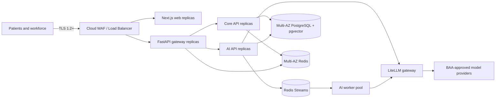
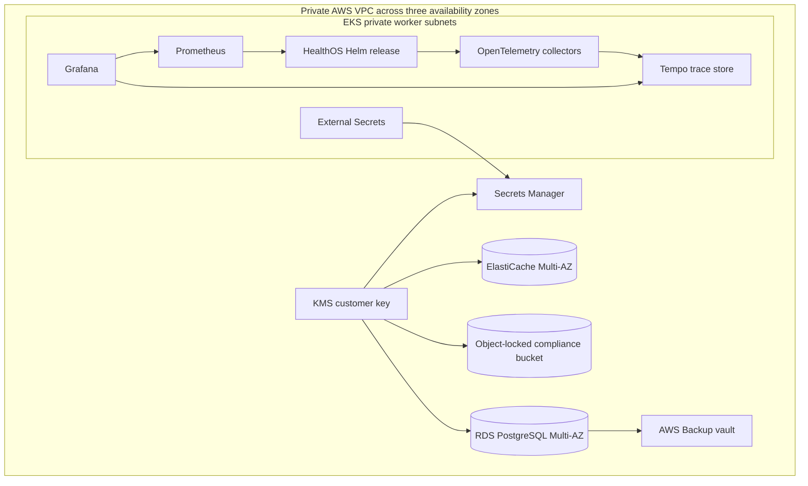

# Production architecture

## Request and data flow

## Cloud and observability topology

## Fault tolerance

- Three replicas for request-serving workloads, spread across zones and nodes.
- Rolling updates permit zero unavailable pods; PodDisruptionBudgets retain quorum during maintenance.
- HPA independently scales web, gateway, API, AI, workers, and LiteLLM.
- RDS and ElastiCache use Multi-AZ failover, private subnets, encryption, and 35-day native recovery windows.
- Redis Streams decouple synchronous APIs from AI workers and reclaim abandoned work.
- Argo CD self-heals drift and blocks rollout when migration hooks fail.

## Trust boundaries

Internet traffic terminates at a managed load balancer/WAF. Only web and gateway services accept ingress-controller traffic. API, AI, workers, and LiteLLM communicate inside default-deny network policies. Data services are reachable only from EKS node security groups over TLS; keep the Helm `networkPolicy.dataPlaneCidr` aligned with the Terraform VPC CIDR. Secrets enter pods from AWS Secrets Manager through short-scoped IRSA credentials.
